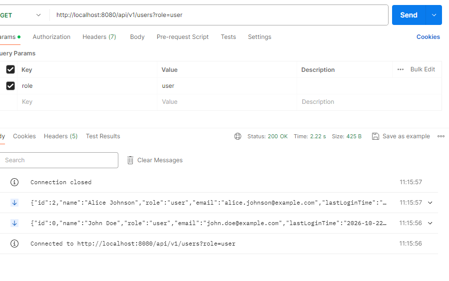

# User Provider

## Java/Spring boot backend
It is a backend that supports [UI dashboard](https://github.com/yingqiaogit/user-dashboard)

### API
- `GET http://localhost:8080/api/v1/users?role=<role>` returns an event stream of users. Supported roles are `manager`, `admin`, `user`, and `all`.
- `POST http://localhost:8080/api/v1/assertion` creates a JWT for the requested role. Send JSON such as `{"role":"manager"}`; supported roles are `manager`, `admin`, and `user`.

### Run
- `mvn install`
- `mvn spring-boot:run`

### Users

