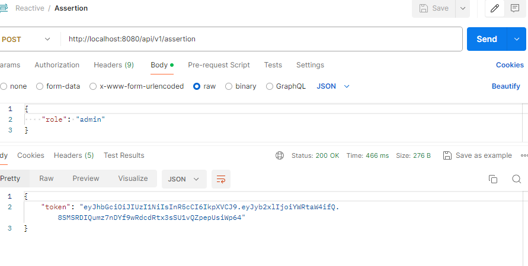
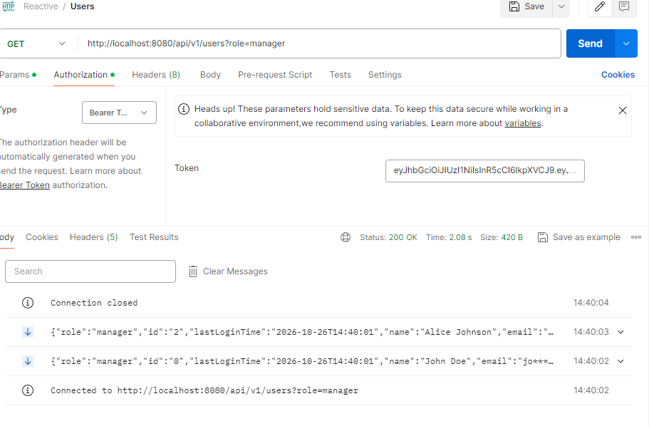

# User Provider

## Java/Spring Boot backend
It is a backend that supports the [UI dashboard](https://github.com/yingqiaogit/user-dashboard)

### Run
- `mvn install`
- `mvn spring-boot:run`

### API
#### Assert Role
Assert a role and receive a JWT token:
- `POST http://localhost:8080/api/v1/roles/assertion` creates a JWT for the requested role. Send JSON such as `{"role": "manager"}`; supported roles are `manager`, `admin`, and `user`.
 

#### Pull Users
Stream out users with 1 second in between:
- `GET http://localhost:8080/api/v1/users?role=<role>` returns an event stream of users. Supported roles are `manager`, `admin`, `user`, and `all`.

